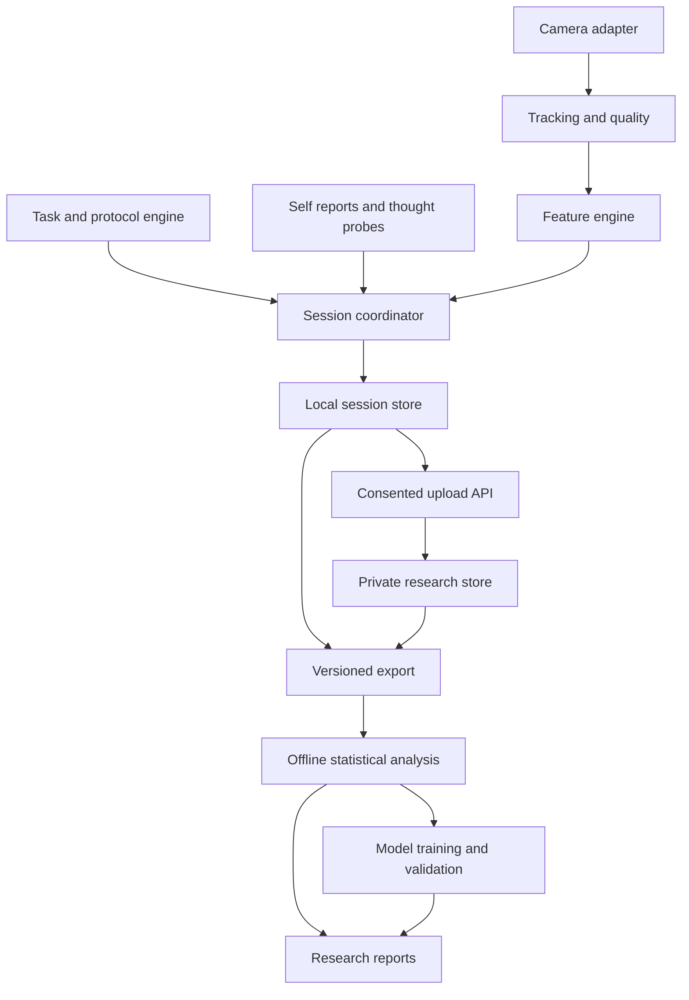

# NeuroLens / Focus Lab architecture plan

## Goal and current baseline

Build a non-invasive ocular, facial and behavioral research platform to investigate cognitive fatigue, self-reported mind wandering and visual behavior. Scientific value comes from experimental design, measurement validation and reproducible analysis.

Focus Lab V1 already collects Go/No-Go performance, pre/post fatigue ratings, browser-derived ocular/head features, local sessions and optional cloud submissions. It does not infer fatigue or mind wandering. This plan merges that implementation with the original NeuroLens framework.

Audited source: main commit `2f72e925e1c90d113cb6a549c14a46b393a5eb3f`, 2026-10-10 Toronto time. See [status](../planning/implementation-status.md).

## Architecture

The diagram describes the target. Implemented and planned components are distinguished in the table below.

| Boundary | Existing implementation | Planned responsibility |
|---|---|---|
| Camera / tracking | Browser getUserMedia, MediaPipe Worker, landmarks and face transform | Performance measurement, blendshapes, independent tracking validation |
| Features | EAR, blink/closure events, iris-position variation, rotation difference | Window features, calibrated coarse gaze, facial dynamics |
| Tasks / session | Go/No-Go, monotonic elapsed time, pre/post ratings, interruption handling | Protocol state machine, baseline, probes, confounders, additional task adapters |
| Persistence | IndexedDB; optional authenticated researcher access to D1 | Backward-compatible exports, validated schema evolution |
| Analysis | Descriptive summaries and two browser plots | Reproducible Python statistics, grouped evaluation, model comparison |
| Reports / extensions | Local results and private table | Scientific reports; video and interview adapters; long-term attention research |

## Technology decisions

- Retain the current Sites/Vinext application, React/TypeScript server surfaces and browser JavaScript collection modules. A rewrite is not a prerequisite.
- Keep MediaPipe inference local in a Worker. Do not add a second Python video pipeline by default.
- Retain IndexedDB, the current API and Cloudflare D1 for collection. Export is the initial analysis boundary.
- Add Python + Pandas/SciPy/Statsmodels/Scikit-learn for offline research when Step 6 begins. Parquet and Plotly may be used for analysis artifacts.
- FastAPI is optional later if a justified analysis service is needed. OpenCV is optional for measurement validation or a future camera adapter. Neither is currently installed or required.
- Do not equate eye-width iris coordinates with screen coordinates, blendshape scores with measured muscle activation, or a cognitive task with a diagnosis.

## Shared engines and applications

The camera/eye-tracker adapter emits observations. The feature engine derives measurements with quality metadata. The task adapter emits task events. The session coordinator owns time, phase, provenance and consent. Analysis consumes the same versioned exports regardless of task.

Application adapters:
1. Cognitive fatigue: baseline and task-window trends with self-ratings.
2. Mind wandering: pre-probe windows paired with explicit self-report labels.
3. Video: local file playback events and calibrated coarse gaze; understanding requires separate comprehension measures.
4. Interview: camera-facing behavior and head/facial timelines; avoid personality or employability judgments.
5. Attention research: sustained-attention performance; no ADHD probability or diagnostic output.

## Version strategy

Product milestones V1/V2/V3 are planning labels, not duplicated source folders. Existing package version 0.1.0 is unchanged by this plan. Tag releases when their acceptance gates pass.

Schema, experiment protocol, feature algorithm and analysis/model versions evolve independently. Historical sessions must retain the definitions used when collected.

## Decisions and change control

Confirmed: preserve working V1 collection and cloud privacy behavior; develop reusable engines; keep analysis reproducible and participant-aware; default to necessary numeric data.

Open: final probe frequency, baseline duration, gaze quality thresholds, facial feature subset and recruitment/sample-size design. Resolve through pilot measurements and record decisions in the relevant protocol/feature document.

See [roadmap](../planning/roadmap.md) for execution order and [repository layout](repository-layout.md) for file ownership.
